<p align="center">
  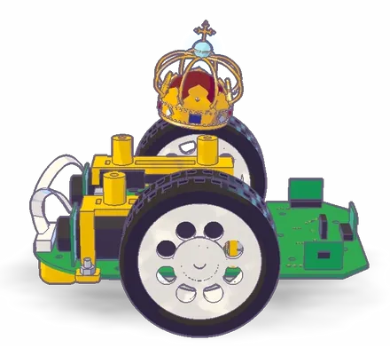
</p>

<h1 align="center">Micromouse</h1>

<p align="center">
  A small robot that maps an unknown maze, finds a target room and sprints back to it, written in MicroPython for an STM32 board.<br>
  Built for EEE3097S at the University of Cape Town in 2026.
</p>

<p align="center">
  
</p>

<p align="center">
  <a href="docs/cad/">3D model (STEP and STL)</a> · <a href="media/8.final_demo.mp4">Final maze run video</a>
</p>

My objective for this project was to learn the fundamentals of embedded software, control and path planning by building a robot that explores a maze on its own. I wrote one program that maps the maze with distance sensors, plans routes with Dijkstra's algorithm and drives the motors through feedback controllers. I did the project alone in the second semester of 2026, from assembling the kit to the final maze run.

## Headline results

My maze scores come from the course Gradescope autograder. It ran my program in the course physics simulator on five mazes, each with a different motor fault.

| Stage | My result |
|---|---|
| Maze autograder total | 58.32 / 60 (97.2%) |
| My micromouse sprint speeds | 0.199 to 0.229 m/s |
| Find the room, pirouette, return, sprint | Full marks on every test, no collisions |
| Square run | 17.0 s, 89.3% combined |
| Square run, straight-line drift over 1 m | Under 0.5 cm |

**Terms used in this README**

- <sub><i><b>PWM:</b> the motor power command, from -100 to 100. Below about 55 the motors on my mouse do not move at all. This dead zone is called the deadband.</i></sub>
- <sub><i><b>ToF sensor:</b> a time-of-flight distance sensor. My mouse uses one facing forward and one on each side.</i></sub>
- <sub><i><b>Encoder and gyro:</b> the encoder counts wheel turns. The gyro measures how fast the mouse is turning.</i></sub>
- <sub><i><b>Dijkstra's algorithm:</b> finds the cheapest route through a graph when the edges have different costs.</i></sub>
- <sub><i><b>Priority queue:</b> a waiting list that always hands back the cheapest item first.</i></sub>
- <sub><i><b>PID controller:</b> turns an error into a correction using the error now (P), its total over time (I) and how fast it changes (D).</i></sub>

## About the code

This course runs every year with the same tasks. To keep it fair and challenging for future students, I am not sharing my full program. In [`pseudocode/`](pseudocode/) I share outlines of two of my classes, `RobotState` and `MotorController`, and a few functions that show the computer science ideas I used. I leave out my tuning numbers and the parts that solve the maze task directly.

## Contents

1. [The task](#the-task)
2. [Core challenges](#core-challenges)
3. [Project timeline](#project-timeline)
4. [My software architecture](#my-software-architecture)
5. [My chosen control system design](#my-chosen-control-system-design)
6. [Maze solving algorithm](#maze-solving-algorithm)
7. [Testing](#testing)
8. [Results](#results)
9. [Limitations and next steps](#limitations-and-next-steps)
10. [Repo structure](#repo-structure)
11. [Credits](#credits)

## The task

The course had two driving tasks. In the first, my mouse had to drive a 1 m square with four 90 degree turns and stay on the line. In the final task, my mouse starts in the corner cell (0, 0) of a maze it has never seen. It has to find the 2x2 target room, enter it and spin a full 360 degrees clockwise. Then it must drive back to the start cell facing its starting direction, wait 3 seconds and sprint back into the room.

The final task was marked in two ways. Gradescope ran my program in the course simulator on five mazes with different motor faults. The sprint speed and the speedup over exploring earned bonus marks. I also had to show the real mouse running the maze, with a video and the run log the mouse saves.

## Core challenges

My hardware was not ideal. In the simulator one motor can be up to 13% weaker than the other, and the wheels can slip by up to 9%. The motors have a large deadband, so small corrections can stall the mouse completely. The gyro drifts over time, the encoders cannot see slip, and the ToF readings are noisy and slightly late.

The computer is small. My program runs in MicroPython on an STM32 board with very little RAM and no threads. The planner, the controllers and the sensor reading all have to share one loop that runs every 10 ms. The same program also had to run unchanged in the course simulator on a PC, because that is where I was graded.

My hardware also failed during the project. The motors on my own mouse shorted and overheated the processor board. I moved my board onto a classmate's chassis, which meant new wheel sizes, motor wiring and gyro scale.

## Project timeline

Let me take you through the journey as it happened.

<table>
<tr>
<td width="44%" align="center" valign="top">
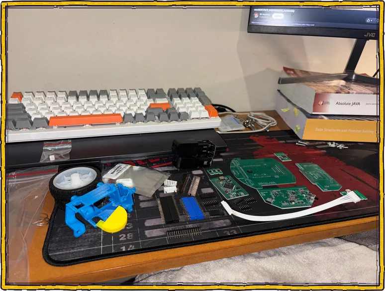
</td>
<td width="56%" valign="top">
<h3>1. The parts</h3>
<p><b>Figure 1. The kit as we got it.</b></p>
<p>We received a kit of loose parts: the main board, the STM32 processor board, the sensor board, two motors with encoders, the wheels, the 3D printed brackets and the cables.</p>
<p>In the first session we were told what each part is and what it does.</p>
</td>
</tr>
<tr>
<td width="56%" valign="top">
<h3>2. Putting it together</h3>
<p><b>Figure 2. My mouse after assembly.</b></p>
<p>Now we slap it together.</p>
<p>I fitted the motors into the brackets, put the wheels on, stacked the boards and plugged in the encoder cables.</p>
</td>
<td width="44%" align="center" valign="top">
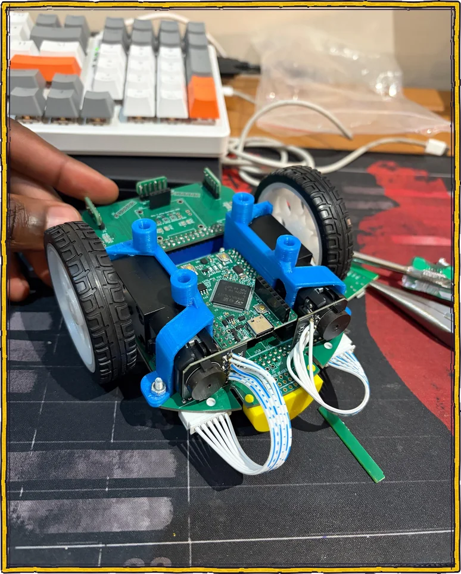
</td>
</tr>
<tr>
<td width="44%" align="center" valign="top">
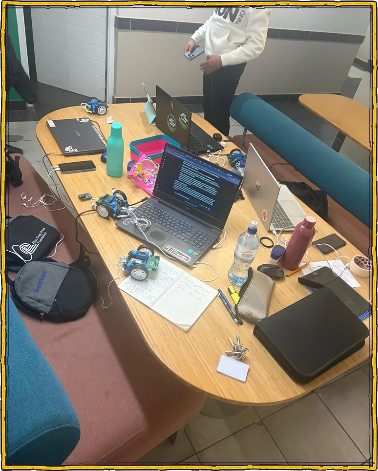
</td>
<td width="56%" valign="top">
<h3>3. Understanding how the mouse works</h3>
<p><b>Figure 3. A late night with the group.</b></p>
<p>Before writing real code, I think we all know how important it is to understand the hardware you will be using.</p>
<p>So one night a group of us sat together and used AI to work out how the mouse operates. We looked at how it reads its sensors, how it drives its motors and how it decides where to go next.</p>
</td>
</tr>
<tr>
<td width="56%" valign="top">
<h3>4. Training for the first task</h3>
<p><b>Figure 4. Training for the square in the lab.</b></p>
<p>The first task was to drive a 1 m by 1 m square. The goal was to get the mouse to drive in a straight line for as long as possible, and then turn an exact 90 degrees. Once it can do that, it can drive a maze, because a maze is just a series of straight lines and 90 degree turns.</p>
<p>This was the hardest part of the course. It took a lot of adjusting to know which part of the mouse to trust for a straight line: the gyro or the encoder counts. One wheel moving faster than the other makes the mouse turn to one side. One wheel slipping or dragging makes it stall on that side.</p>
</td>
<td width="44%" align="center" valign="top">
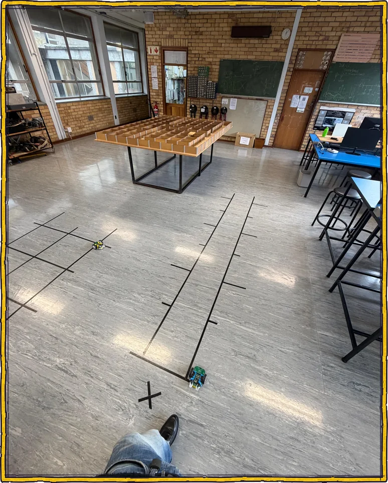
</td>
</tr>
<tr>
<td width="44%" align="center" valign="top">
<a href="media/5.square.mp4">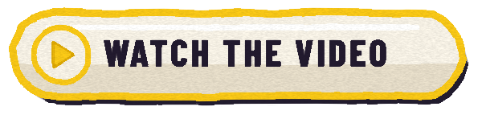</a><br>
<a href="media/5.square.mp4">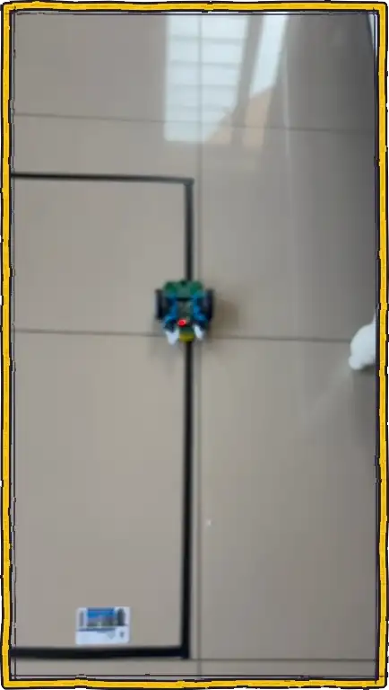</a>
</td>
<td width="56%" valign="top">
<h3>5. Completing the square</h3>
<p><b>Figure 5. My square run.</b></p>
<p>We did manage to get it to turn a clean 90 degrees, but only after a series of controller designs.</p>
<p>I started with a proportional controller, because at the time that was all we had covered in our controls lectures. Then I followed YouTube videos to add the other terms, which did not help much at first. In the end I landed on PID, which gave me my 90 degree turns.</p>
<p>After writing my own simple version, I used AI to refine it and give me ideas on how to make the mouse think more for itself and correct itself. Before that, my code was just drive straight, turn 90, drive straight, turn 90. The mouse would think it had turned 90 degrees, with no way to check.</p>
</td>
</tr>
<tr>
<td width="56%" valign="top">
<h3>6. A kit update</h3>
<p><b>Figure 6. Moving to another mouse.</b></p>
<p>Not too long after, my motors started shorting during runs, which overheated my processor board.</p>
<p>So my mouse needed a little kit update. I moved my board and code onto another chassis, and checked the motors, wheels, encoders and gyro all over again.</p>
</td>
<td width="44%" align="center" valign="top">
<a href="media/6.damaged_mouse.mp4"></a><br>
<a href="media/6.damaged_mouse.mp4">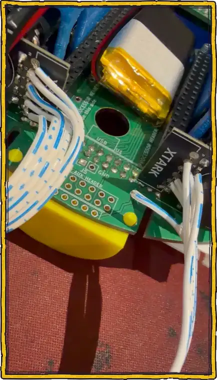</a>
</td>
</tr>
<tr>
<td width="44%" align="center" valign="top">
<a href="media/7.maze_running_circles.mp4"></a><br>
<a href="media/7.maze_running_circles.mp4">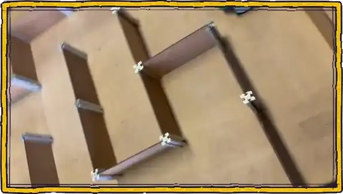</a>
</td>
<td width="56%" valign="top">
<h3>7. Learning the maze</h3>
<p><b>Figure 7. My first maze search, running in circles.</b></p>
<p>Then we moved on to the maze. My first search had no memory of where it had been, so it kept running in circles, as you can see here.</p>
<p>I went through a lot of path finding algorithms: wall following, depth-first search, breadth-first search, flood fill and A*. I landed on Dijkstra's algorithm. On a real mouse a turn takes about as long as driving a cell, so some moves cost more than others. Dijkstra finds the cheapest route when the costs are different, and one search can find the nearest of many unexplored cells.</p>
<p>My mouse now keeps a map of every wall it has seen and plans its next move on that map. I explain how in <a href="#maze-solving-algorithm">Maze solving algorithm</a>.</p>
</td>
</tr>
<tr>
<td width="56%" valign="top">
<h3>8. The final demo</h3>
<p><b>Figure 8. My final run.</b></p>
<p>In the final run, my mouse starts in a corner of a maze it has never seen. It has to explore until it finds the 2x2 target room, drive in and spin a full circle. Then it drives back to the start, waits 3 seconds and sprints back to the room on the fastest route it found.</p>
<p>Everything came together. My mouse explored the maze, found the room and finished the whole run.</p>
</td>
<td width="44%" align="center" valign="top">
<a href="media/8.final_demo.mp4"></a><br>
<a href="media/8.final_demo.mp4">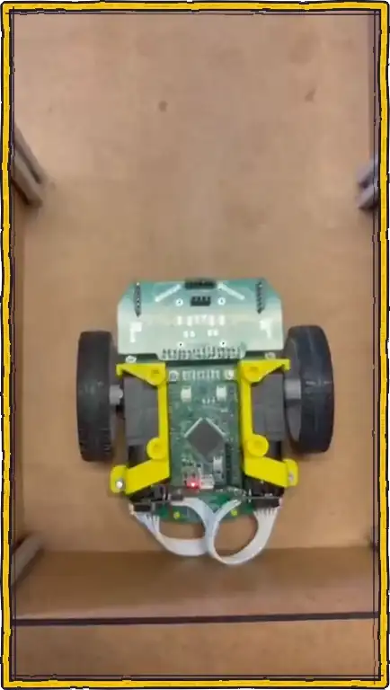</a>
</td>
</tr>
</table>

## My software architecture

I structured my program as one MicroPython file of about 2,500 lines. I compile it to a `.mpy` file for the board, because it loads faster and uses less RAM than plain source.

It did not start this big. For the square run I only had three pieces: `RobotState` to hold the numbers like the heading, `MotorController` to drive the wheels, and a small scheduler that reads the sensors every 10 ms. That was enough to drive straight and turn 90 degrees.

When the maze came, I added `MazeMission` to run the phases of the task, and `MazeMemory` with a set of planner functions to store the walls and find routes. After that I worked with a more capable AI to review my code. It suggested a lot of extra checks, which I added one by one: learning the motor imbalance, predicting where the mouse will stop, centring between the walls, fixing gyro drift from the side walls, retrying a turn that ends too far off, and trusting walls the mouse has already driven through. That is how I got to the layout below.

<p align="center">
  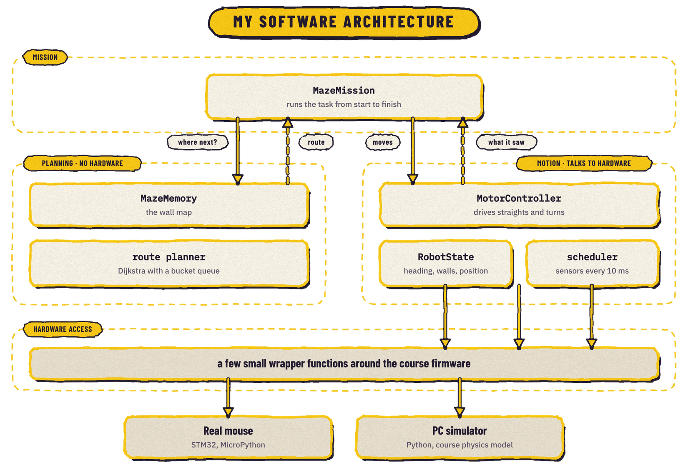
  <br><i>Figure 10. How I split my program into layers.</i>
</p>

I kept the planning layer away from the hardware. It takes a map and a position and returns a list of cells. Because of this, I could run it on my laptop on hundreds of random mazes without a robot. My motion layer is the opposite. It knows nothing about the maze and only knows how to drive one straight or one turn and report what it saw.

### My classes

| Class | Its one job | Why it is separate |
|---|---|---|
| `RobotState` | Holds the numbers: heading, gyro offset, filtered wall distances, cell and facing | Many parts read these. Keeping them in one place means there is one true heading. |
| `MotorController` | Drives one straight, one turn or one wall scan, and learns the motor imbalance | The control code can be tuned with test modes without running a whole mission. |
| `MazeMemory` | Stores the walls the mouse has seen | Pure data with no motors, so it is easy to test. |
| `MazeMission` | Runs the task from start to finish and keeps the run log | The only class that knows the order of the task. |

There are no threads on the board, so I run everything from one loop. Each control step does its maths, waits 10 ms, then runs a background job that reads the gyro and the ToF sensors.

I wrote the planner as a set of plain functions, not a class. They take a `MazeMemory` and return a path, and they keep no state between calls.

## My chosen control system design

### For the square run

For the square run I used a discrete controller on the gyro heading. I get the heading by adding up the gyro rate over time, after removing the gyro's zero offset.

### For the straight-line drive

In the maze, my straight drive uses two loops, one inside the other. My inner loop is a PID controller that holds the heading. Its I term learns how much stronger one motor is than the other. I also stop the I term from growing while the steering is at its limit, which is called anti-windup.

<p align="center">
  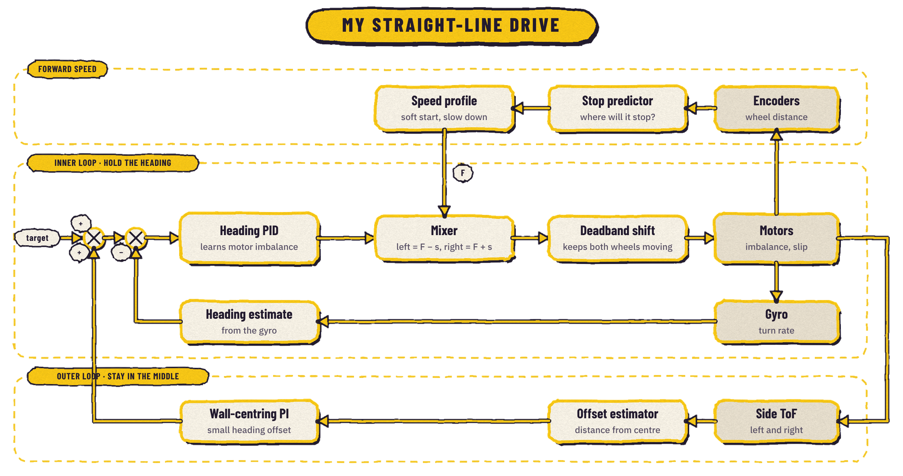
  <br><i>Figure 11. My controller that keeps the mouse straight and centred.</i>
</p>

My outer loop keeps the mouse in the middle of the passage. It turns the side offset into a small heading target for the inner loop. I chose its gains with pole placement, worked out per metre driven instead of per second, so the correction feels the same at any speed. I left the forward speed open loop, with a stop predictor that helps the mouse stop near the middle of a cell.

### For turning in place

My turn controller is a small state machine. It cuts the power a little before the target so the mouse coasts in instead of overshooting. It only judges the result once the mouse is still, and tries again if it is too far off.

## Maze solving algorithm

This is the computer science core of my project. A simplified version of the planner is in [`pseudocode/cs_concepts.md`](pseudocode/cs_concepts.md).

### Storing the walls

My map stores each side of each cell as UNKNOWN, OPEN or WALL. Every inside wall belongs to two cells, so I keep one rule always true: both copies must match. Every write updates the cell and its neighbour at the same time.

### The graph

A normal maze solver treats each cell as one node. On a real mouse that gives bad routes, because a turn takes about as long as driving a cell. A route with fewer turns can be faster even if it is longer. So my graph has one node for each (cell, heading) pair.

There are two kinds of edges. A turn edge joins two headings in the same cell. A move edge joins (cell, heading) to (next cell, same heading), and only exists if that side of the cell is OPEN. Turns cost more while sprinting than while exploring, so the sprint prefers long straight runs.

### Dijkstra's algorithm with a bucket queue

All edge costs are positive but not equal, so a plain breadth-first search is not enough. Dijkstra's algorithm handles different costs. It keeps a waiting list of nodes, always takes out the cheapest one, and updates the cost of its neighbours if it found a cheaper way to reach them. The usual waiting list is a heap, where each insert and removal costs O(log n).

My costs are small whole numbers. If the biggest single step is `k`, every waiting node costs between the current cost `c` and `c + k`. So a ring of `k + 1` lists, indexed by `cost % (k + 1)`, can replace the heap. Adding a node is one `append`. Taking the next node means moving `c` forward to the next list that is not empty.

```python
# simplified, see pseudocode/cs_concepts.md
buckets = [[] for _ in range(k + 1)]
buckets[0].append(start)
c = 0
while any_bucket_not_empty:
    for node in take_all(buckets[c % (k + 1)]):
        if cost[node] != c:
            continue                          # stale copy, a cheaper one was found
        if node is a goal:
            return the route back to start
        for each neighbour of node:
            new = c + step_cost(node, neighbour)
            if new < cost[neighbour]:
                cost[neighbour] = new
                parent[neighbour] = node
                buckets[new % (k + 1)].append(neighbour)
    c += 1
```

There is no "decrease key" step like a heap needs. When a cheaper way to a node is found, the node is simply added again. The old copy stays in its bucket and is skipped later because its cost no longer matches. This is called lazy deletion.

The time cost is O(V + E + C). V is the number of nodes, E the number of edges and C the highest cost reached. With a heap it would be O(E log V). The bucket queue mattered more for memory and for speed on a slow board, because the planner runs again after every wall reading.

### Exploring

<p align="center">
  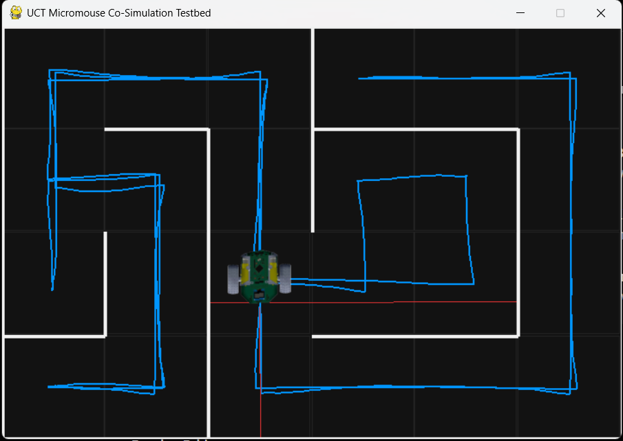
  <br><i>Figure 9. My mouse exploring a maze in the course simulator. The blue line is its path and the red lines are its distance sensors.</i>
</p>

While exploring, the goals are all frontier cells. A frontier cell still has at least one side the mouse has not seen. Dijkstra accepts a set of goals and stops at the cheapest one, so one search finds the best next cell.

### Mission state machine

EXPLORE → GO_TO_ROOM → PIROUETTE → RETURN → PAUSE → SPRINT → FINISH, or ABORT if something goes wrong.

Each phase is its own method, and one loop moves from phase to phase. This made each phase easy to test on its own.

## Testing

I built a test harness that runs my program against the course physics model with a fixed random seed. It records every call the program makes to the motors and sensors. When I cleaned up the code, I ran the old and new versions on the same mazes and compared the two recordings. They had to be identical before I allowed any change that affects behaviour. This is a form of regression testing. For speed changes, I ran each setting on 50 tuning mazes and then on 80 mazes it had not seen. A setting was only kept if every run finished without touching a wall.

The run log on my real mouse caught a bug the simulator could not. One early run turned back from a long open corridor. The log showed I had given the mouse the wrong maze size, so it was chasing a possible room in rows that did not exist.

## Results

### How my mouse was marked

The course did not mark the maze by hand. It used an autograder on Gradescope. When I uploaded my code, the autograder ran it in the course physics simulator on five different mazes. Each maze had a different problem built in, like one motor being stronger than the other or the wheels slipping. This checks that the mouse still works when the hardware is not perfect.

Each test was marked out of 100%, in three parts:

| Part | Worth | How it is measured |
|---|---|---|
| The mission | 90% | Did the mouse find the room, spin a full circle in it, drive back to the start and sprint back to the room, without hitting a wall? |
| Sprint speed bonus | 5% | The length of the sprint route divided by the time it took. 0.15 m/s or slower earns nothing, 0.30 m/s or faster earns the full 5%, and anything between earns part of it. |
| Speedup bonus | 5% | How much faster the sprint is than the first time the mouse drove through while exploring. 1.35 times faster or more earns the full 5%. |

The five test scores are then added up to a total out of 60.

### My scores

<p align="center">
  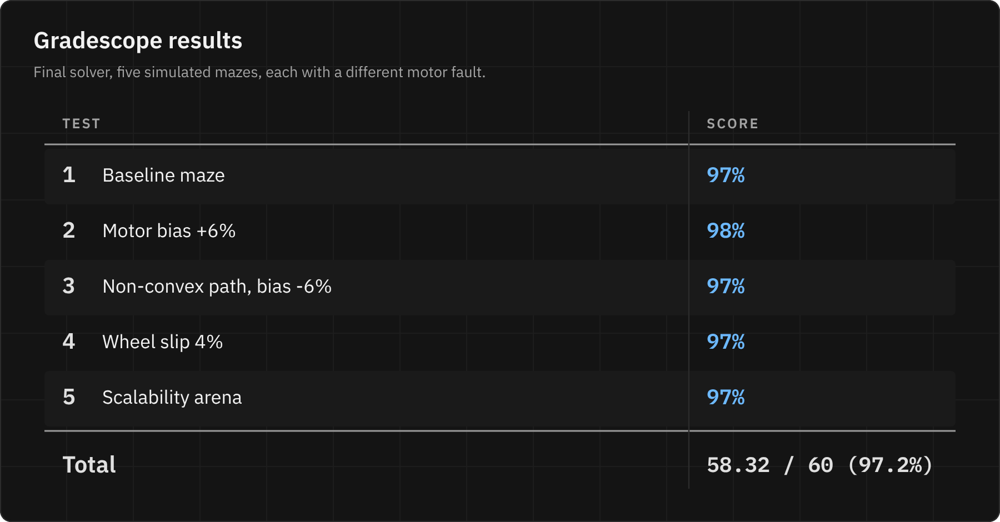
  <br><i>Figure 12. My Gradescope results.</i>
</p>

My mouse got the full 90% for the mission on all five tests, with no collisions. It also got the full speedup bonus every time, because my sprint was about twice as fast as exploring. The only marks I lost were on the sprint speed bonus. My sprints ran at 0.199 to 0.229 m/s, which is only a third to a half of the way from 0.15 to the 0.30 m/s needed for the full bonus. That is why each test sits at 97% or 98% instead of 100%.

## Limitations and next steps

My sprint still stops and spins at every corner. The top sprint bonus needs 0.30 m/s, and my best safe result is about 0.21 m/s. Getting there needs smooth turns at speed, which needs better position sensing at the corners. The forward speed is also open loop, so it changes with the battery level.

I have an experimental version that reads side walls while driving past each cell and maps a whole corridor from one front reading. In the simulator it cuts the mission time from 53.0 s to 40.4 s. It does not raise the grade so I chose to rest after completing this hell rid-, I mean very fun engineering project :). So perhaps in the future, smooth turns while exploring, and combining the gyro and wheel angles during turns is worth improving.

## Repo structure

```text
Micromouse/
├── README.md                    this file
├── media/                       the photos and videos from the timeline, numbered 1 to 8
├── pseudocode/
│   ├── README.md                why only part of the program is shared
│   ├── robot_state.md           outline of my RobotState class
│   ├── motor_controller.md      outline of my MotorController class
│   └── cs_concepts.md           scheduler, shared-edge map, bucket-queue Dijkstra
├── docs/
│   ├── cad/
│   │   ├── micromouse.step      3D model, opens in Fusion 360 with part names and colours
│   │   ├── micromouse.stl       the same model as a mesh, GitHub shows it in a 3D viewer
│   │   ├── build_model.py       CadQuery script that builds the model
│   │   └── README.md            how the model was made and how to open it
│   ├── diagrams/                the two diagrams and the results table in this README
│   └── images/
│       ├── model_spin.webp      the turning model at the top of this README
│       ├── fig5 to fig8 .webp   short previews of the videos
│       └── README.md            which file goes with which figure
└── .gitignore
```

## Credits

I did this project for EEE3097S at the University of Cape Town in 2026. The kit, the course firmware, the physics simulator and the autograder were provided by the course staff. Thank you to the classmate who lent me their mouse chassis after my motors failed. I used AI-assisted tools for parts of the coding and the documentation, but most of the planning and documenting was done by me.

All photos and videos in this repo are my own.
